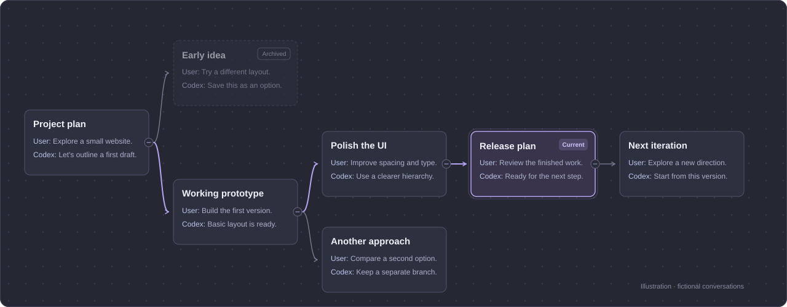

# SessionTree

A conversation tree for Codex. Follow the origin and forks of a chat, see recent user and Codex messages, and jump between conversations. Search, pan, zoom, and collapse branches; the UI follows your client language.

## Install

For Codex desktop on Windows x64. The package includes its runtime.

The 0.6.0 universal preview migrates the UI to React + TypeScript + Vite and bundles Windows x64, Apple Silicon Mac and Intel Mac runtimes in one ZIP. See the [development guide](docs/DEVELOPMENT.md) to build and validate the preview. The installation links below remain on stable 0.5.8 while native desktop acceptance is pending.

Open **Plugins（插件）** in the **left sidebar**, then click **Add（添加）** in the **upper-right corner**. Choose either method below.

**Option 1 — Upload the plugin ZIP**

1. Download [session-tree-0.5.8-windows-x64-plugin.zip](https://github.com/ether-zhang/SessionTree/releases/download/v0.5.8/session-tree-0.5.8-windows-x64-plugin.zip).
2. Select **Upload plugin archive（上传插件压缩包）** and choose the ZIP without unpacking it.
3. Follow the prompts to finish importing and installing SessionTree.

**Option 2 — Add the plugin marketplace**

1. Select **Add plugin marketplace（添加插件市场）**.
2. Fill in the following fields:

| Field | Value |
| --- | --- |
| Source（来源） | `ether-zhang/SessionTree` |
| Git ref（Git 引用） | `marketplace` |
| Sparse paths（稀疏路径） | Leave empty |

3. Click **Add marketplace（添加市场）**, select the **SessionTree (Windows x64)** source, and click **Install（安装）** on SessionTree.

Use one installation method to avoid duplicate copies. Reopen the client if needed. Open the tree from a conversation's right-hand pane: **New tab → More tools → Session Tree**.

[Development guide](docs/DEVELOPMENT.md) · [Support](SUPPORT.md) · [Privacy](docs/PRIVACY.md) · [MIT License](LICENSE)
