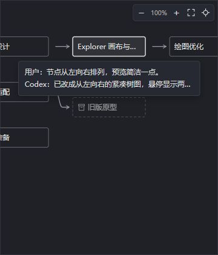

# SessionTree for VS Code

Explore your Codex conversation forks as a tree, right inside **Explorer**. Preview a conversation, follow its branches, and click a node to open it in Codex.

## Get started

Install your platform's VSIX through **Extensions → ⋯ → Install from VSIX…**. No separate runtime installation is needed.

1. Expand **SessionTree** in Explorer.
2. Choose a conversation to see its tree.
3. Hover a node for **User / Codex** previews; click to open the conversation in the Codex extension.

Drag to pan, scroll to zoom, or use the canvas controls to fit the tree and locate the selected node. The title-bar back arrow returns to the conversation list. Archived conversations are marked and cannot be opened.

SessionTree reads local conversations without uploading their contents or editing them. If your conversations are missing, check **Settings → SessionTree → Codex Home**.

[Development & compatibility](DEVELOPMENT.md) · [Source](https://github.com/ether-zhang/SessionTree) · [Report an issue](https://github.com/ether-zhang/SessionTree/issues) · [Privacy](https://github.com/ether-zhang/SessionTree/blob/main/docs/PRIVACY.md) · MIT License
